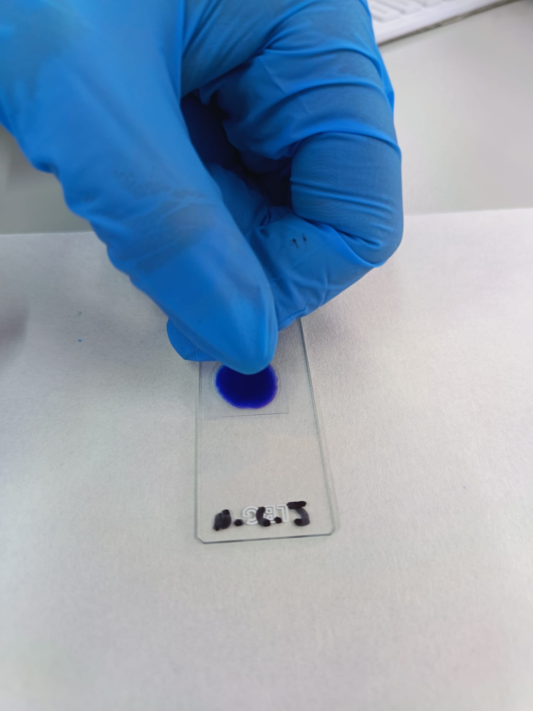
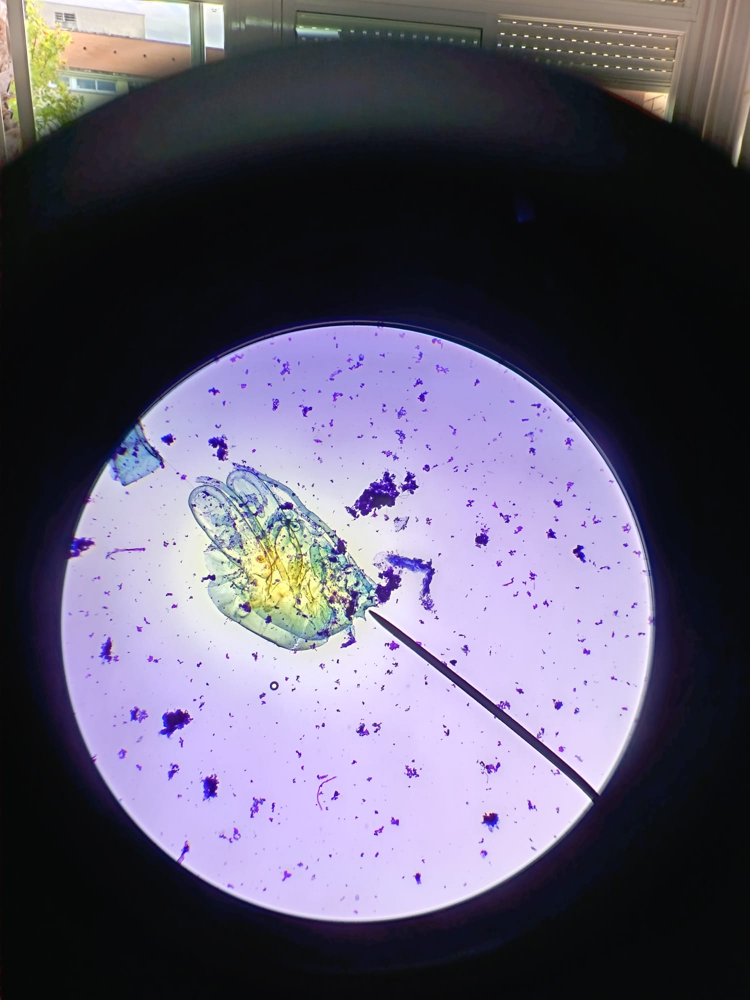
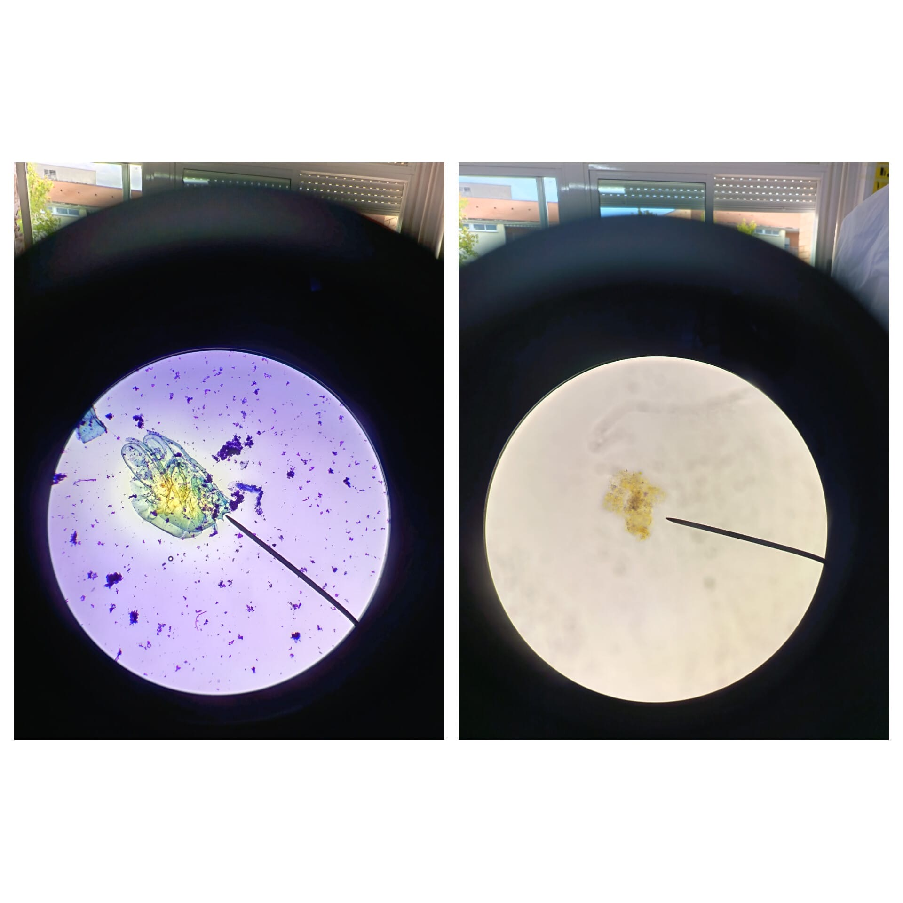

# P03 — Tinción vital con azul de metileno

> **Estado de esta página:** Completa individualmente los bloques **[ALUMNADO · RELLENABLE]** durante o después de la práctica. La preparación puede realizarse por parejas, pero el registro, la interpretación comparada, las imágenes seleccionadas y la reflexión deben ser personales.

## 1. Identificación de la práctica

| Campo | Información |
|---|---|
| Código y título | `P03 — Tinción vital con azul de metileno` |
| Unidad didáctica | `UD2 — Bacteriología: técnicas de tinción y observación` |
| Resultado de aprendizaje | `RA02` |
| Criterios de evaluación | `CE02.a–CE02.g` |
| Aprendizaje transversal | `RA01 — bioseguridad` |
| Agrupamiento | Preparación y manejo del microscopio por parejas; interpretación y registro individual. |
| Instrumentos vinculados | Prueba práctica, cuaderno o portfolio de prácticas y prueba teórica. |
| Modalidad prevista | Muestra autorizada o material docente seguro, colorante azul de metileno vigente y documentación de seguridad disponible. |

## 2. Resumen

En esta práctica aplicarás o interpretarás una tinción vital con azul de metileno para aumentar el contraste de una preparación y observar mejor algunas estructuras celulares. Prepararás el material, identificarás la muestra y el reactivo, aplicarás la secuencia de tinción indicada y compararás el resultado con una observación en fresco. Registrarás concentraciones, tiempos, aumentos, controles y posibles cambios producidos por el colorante. También valorarás si la preparación permite interpretar la morfología o si existen artefactos. El resultado esperado es una comparación razonada entre ambas preparaciones, con imágenes autorizadas, descripción técnica y una conclusión que no confunda la mejora del contraste con una identificación definitiva.

## 3. Finalidad y resultados esperados

La tinción vital con azul de metileno se utiliza para incrementar el contraste de una preparación y facilitar la observación microscópica. Esta práctica permite seleccionar el material y el colorante apropiados, preparar una muestra teñida, realizar una observación de calidad y compararla con la preparación en fresco de P02.

Al finalizar deberás poder:

- manipular un colorante de forma segura conforme a su FDS;
- preparar una tinción vital válida, sin comprometer la calidad de la muestra;
- observar y describir las estructuras visibles tras la tinción;
- comparar el contraste, la morfología observable y las limitaciones de una preparación teñida frente a una preparación en fresco; y
- comunicar el resultado mediante registro técnico, imágenes y una interpretación razonada.

## 4. Recursos, seguridad y autorización

**Recursos previstos:** microscopio óptico, portaobjetos y cubreobjetos limpios, pipeta Pasteur o gotero, papel absorbente, muestra o preparación docente autorizada y solución de azul de metileno apta para uso docente.

**Responsabilidad del centro:** proporcionar un reactivo vigente, correctamente etiquetado y con la ficha de datos de seguridad (FDS) accesible. La preparación de disoluciones, las concentraciones, el posible uso de vaselina, la opción de concentrar una muestra y los aumentos del microscopio deben ajustarse al protocolo validado por el centro; no se deducen automáticamente de la guía histórica de referencia.

**Riesgos:** exposición al colorante, salpicaduras, manchas, contacto con muestra autorizada, rotura o corte con vidrio y gestión incorrecta de residuos químicos.

**Medidas obligatorias:** usar el EPI indicado por la FDS y el centro; evitar salpicaduras y aerosoles; trabajar sobre una superficie protegida cuando se indique; no pipetear con la boca; gestionar el colorante y el vidrio por la ruta de residuos comunicada; limpiar el puesto e higienizar las manos al finalizar.

> **Aviso de seguridad.** La práctica es `CONDITIONAL`: requiere reactivo vigente, FDS disponible, material docente autorizado, EPI y circuito de residuos químicos confirmado. Si falta alguno de estos elementos, se utilizarán preparaciones teñidas, imágenes o resultados docentes ya preparados, identificándolos como tales.

## 5. Fundamento técnico

Las tinciones vitales emplean colorantes de baja toxicidad y a baja concentración para aumentar el contraste de la preparación y mejorar la visualización. El azul de metileno puede resaltar determinadas estructuras, pero la tinción puede modificar la percepción de la muestra y no debe interpretarse como una identificación definitiva.

La comparación con la preparación en fresco es esencial: la tinción puede facilitar el reconocimiento de contornos y detalles, mientras que la preparación sin teñir puede aportar otra información sobre el comportamiento de la muestra. Cualquier movimiento observado debe analizarse con cautela, diferenciándolo de corrientes, vibraciones o artefactos.

El documento adjunto propone una preparación directa y otra tras concentración, así como una formulación histórica de la disolución. Se utiliza solo como referencia técnica. La concentración, el método de preparación, la centrifugación y el sellado efectivos serán los que establezca el centro conforme a la FDS y los protocolos actuales.

## 6. Procedimiento y controles de calidad

### Procedimiento base

1. Revisar la autorización de la muestra o del material docente, la FDS, el EPI y el circuito de residuos.
2. Preparar un portaobjetos y cubreobjetos limpios, y etiquetar la preparación según las indicaciones recibidas.
3. Depositar la cantidad de muestra indicada por el centro en el portaobjetos.
4. Añadir la cantidad indicada de solución de azul de metileno y homogeneizar con el método autorizado, evitando salpicaduras y exceso de manipulación.
5. Colocar el cubreobjetos inclinado para reducir la formación de burbujas; aplicar el método de sellado únicamente si ha sido autorizado.
6. Observar al microscopio de menor a mayor aumento, registrando el aumento y los ajustes efectivamente utilizados.
7. Comparar la preparación teñida con la observación en fresco, registrar las diferencias y seleccionar evidencias visuales válidas.
8. Retirar la preparación, limpiar el puesto y gestionar los residuos químicos y de vidrio conforme al protocolo.

### Procedimiento específico

**[PNT](https://seimc.org/wp-content/uploads/2025/06/seimc-procedimientomicrobiologia1a.pdf) de referencia:** [SEIMC, procedimiento 1a: procesamiento general de muestras](https://seimc.org/wp-content/uploads/2025/06/seimc-procedimientomicrobiologia1a.pdf)

1. Verifica muestra, azul de metileno, ficha de seguridad, portaobjetos, cubreobjetos y microscopio; usa EPI y etiqueta.
2. Deposita la cantidad indicada de muestra con pipeta o asa, evitando salpicaduras y contaminación cruzada.
3. Añade azul de metileno con gotero o pipeta; mezcla suavemente y respeta concentración y tiempo autorizados.
4. Coloca el cubreobjetos inclinado y elimina exceso sin presionar; sella solo si el procedimiento lo autoriza.
5. Observa de menor a mayor aumento; registra contraste, forma, distribución celular y aumento utilizado.
6. Compara con una preparación en fresco o control; identifica sobreteñido, precipitado y burbujas como limitaciones.
7. Gestiona colorante, vidrio y material contaminado en recipientes designados; limpia y registra la evidencia.

### Controles de calidad

- Reactivo identificado, vigente y utilizado conforme a la FDS.
- Preparación limpia, correctamente rotulada y sin burbujas que impidan la lectura.
- Cantidad de colorante y homogeneización adecuadas: sin precipitados o sobreteñido que impidan interpretar el campo.
- Enfoque, iluminación y aumento adecuados para la observación.
- Comparación explícita y razonada con la preparación en fresco.
- Imagen o esquema suficiente para apoyar el resultado, con pie de foto técnico y origen declarado.

---

# Tu cuaderno de prácticas

## 7. Datos de realización [ALUMNADO · RELLENABLE · DURANTE]

- **Nombre y apellidos:** Natalia Carrasco Jiménez
- **Fecha real de realización:** 01/10/2026
- **Grupo:** 2ºLaboratorio Clínico y Biomédico
- **Pareja de trabajo, si procede:** Trabajo individual
- **Rol o tarea principal que realizaste:** Teñir con azul de metileno la gota de agua estancada que deposito en el portaobjetos y visualizarla al microscopio.
- **Modalidad realmente realizada:** Preparación docente teñida 
- **Código o descripción de la muestra/material docente: Muestra de agua estancada procedente de una charca,utilizada como material docente para la práctica de tinción con azul de metileno y posterior observación microscópica.
- **Reactivo utilizado:** Nombre:azul de metileno;concentración:no especificada;lote o referencia:no indicado.

## 8. Preparación y análisis inicial [ALUMNADO · RELLENABLE · DURANTE]

### 8.1 Verificación previa

| Comprobación | Registro |
|---|---|
| Autorización o modalidad segura de la muestra | Muestra de agua estancada de una charca utilizada con fines docentes.No es una muestra clínica. |
| FDS y estado del reactivo | Se utilizó azul de metileno.Se comprobó su estado y aspecto antes de utilizarlo.No se dispone información sobre lote ni la concentración. |
| EPI y medidas de seguridad aplicadas | Uso de bata y guantes.Se evitó el contacto directo con el colorante y se mantuvo limpia la zona de trabajo. |
| Estado del portaobjetos y cubreobjetos | Portaobjetos y cubreobjetos limpios,secos y sin roturas visibles antes de realizar la preparación. |
| Aumento(s) utilizado(s) | Objetivos de 10x y 40x |

### 8.2 Hipótesis de comparación

Antes de observar, indica qué diferencia esperas encontrar entre la preparación en fresco de P02 y la preparación teñida con azul de metileno. Si trabajaste con una imagen o preparación docente, formula la hipótesis a partir de la información disponible.

Se espera que en la preparación en fresco se observen los microorganismos en su estado natural,pudiendo apreciar mejor su movimiento,mientras que en la preparación teñida con azul de metileno se espera observar un mayor contraste y distinguir mejor algunas estructuras celulares. 

## 10. Controles y resultados de la tinción [ALUMNADO · RELLENABLE · DURANTE]

### 10.1 Comprobación de calidad

| Control o criterio | Evidencia observada | ¿Resultado válido? | Justificación |
|---|---|---|---|
| Reactivo correctamente identificado y apto para uso | Se comprobó que el reactivo era azul de metileno y que estaba en condiciones de uso|Sí| El color estaba correctamente identificado y permitió realizar la tinción |
| Preparación sin burbujas o artefactos limitantes | Se observo la preparación,comprobando que no hubiera burbujas que dificulten la visión(si que había alguna pero pequeña) | Sí | Las burbujas pueden dificultar la observación de la muestra |
| Contraste suficiente para la observación | La muestra presentó una coloración azul que facilitó distinguir algunas estructuras | Sí | El azul de metileno aumenta el contraste y facilita la observación microscópica |
| Enfoque e iluminación adecuados | Se ajusto el enfoque y la iluminación del microscopio hasta conseguir una imagen clara | Sí | Permite observar mejor las estructuras presentes en la muestra |
| Gestión correcta de residuos y limpieza | Se limpiaron los materiales y se eliminaron los residuos siguiendo las normas del laboratorio | Sí | Evita contaminaciones y mantiene el puesto d triscado limpio y seguro |

### 10.2 Registro de hallazgos

| Campo o elemento observado | Aspecto tras la tinción | ¿Qué detalle permite apreciar? | Limitación o duda |
|---|---|---|---|
| [Observación 1] | [Completa] | [Completa] | [Completa] |
| [Observación 2] | [Completa] | [Completa] | [Completa] |
| [Observación 3] | [Completa] | [Completa] | [Completa] |

## 11. Comparación con la observación en fresco [ALUMNADO · RELLENABLE · DURANTE Y DESPUÉS]

| Aspecto comparado | P02 — Observación de agua estancada mediante preparación en fresco | P03 — Tinción vital con azul de metileno | Interpretación de la diferencia |
|---|---|---|---|
| Contraste | Bajo,se observaron los microorganismos con poco contraste | Mayor contraste gracias a la coloración azul | El colorante facilita distinguir las estructuras de la muestra |
| Morfología o detalles visibles | Se apreciaba la forma general de algunos microorganismos | Se podían distinguir mejor algunas formas y detalles celulares | La tinción mejora la visualización de las estrucuras |
| Movimiento observado | Se podrán observar movimientos de algún microorganismo | Los movimientos eran difíciles de observar o no se apreciaban | La tinción puede alterar o impedir el movimiento natural de los microorganismos |
| Facilidad de observación | Era más difícil gobernarte algunas estructuras por la falta de contraste | Resultaba más fácil identificar formas por la coloración | El azul de metileno facilita la observación microscópica |
| Limitaciones | El bajo contraste dificultaba observar algunos detalles | La tinción podía alterar las estructuras y dificultar la observación de movimientos | Cada técnica tiene sus ventajas y limitaciones |

### Resultado principal

Resume qué aportó la tinción a la observación y qué información debe interpretarse con cautela. Indica expresamente si el resultado procede de una ejecución propia, una preparación docente o material audiovisual.

La tinción con azul de metileno permitió mejorar el contraste y facilitar la observación de las estructuras presentes en la muestra de agua estancada.Se distinguió en elaboración de forma ovalada y aparentes partículas y restos.Sin embargo,la coloración puede alterar el aspecto natural de los organismos, por lo que no se puede identificar con seguridad su especie (fuente creemos que puede ser una bosmina,pulga de agua).
Origen del resultado: ejecución propia de la práctica, mediante tinción de una muestra de agua estancada, con azul de metileno y su posterior observación al microscopio.

## 12. Evidencias visuales [ALUMNADO · RELLENABLE · DURANTE Y DESPUÉS]

> Sube imágenes propias, pertinentes y tomadas de acuerdo con las normas del centro. No incluyas rostros, datos personales, etiquetas con información sensible ni material cuya fotografía esté prohibida. Si la evidencia procede de una preparación docente, una imagen de referencia o un vídeo, indícalo: no puede presentarse como una ejecución propia.

### Imagen 1 — Proceso de tinción

- **Pie de foto:** [Qué se observa: preparación, adición del colorante o colocación del cubreobjetos]
- **Medida de seguridad o calidad que demuestra:** [Completa]
- **Autoría y origen:** [Propia / compartida con tu pareja / material docente autorizado]

### Imagen 2 — Campo microscópico teñido

- **Pie de foto:** [Qué se observa y con qué aumento o configuración]
- **Elemento o contraste señalado:** [Describe el elemento de interés]
- **Origen de la imagen:** [Observación propia / material docente / vídeo; especifica]

### Imagen 3 — Comparación o resultado final

- **Pie de foto:** [Qué diferencia entre P02 y P03 o qué conclusión técnica evidencia]
- **Relación con la interpretación:** [Explica cómo esta evidencia respalda o limita tu resultado]
- **Autoría y origen:** [Completa]

## 13. Incidencias, errores y medidas correctoras [ALUMNADO · RELLENABLE · DURANTE]

| Incidencia, error o duda detectada | Posible causa | Medida correctora aplicada o propuesta | ¿Afectó al resultado? |
|---|---|---|---|
| Dificultad para identificar el organismo | Falta de detalles suficientes para reconocerlo | Mejorar el enfoque y observar con distintos aumentos | Sí,limitó su identificación |

## 14. Interpretación técnica [ALUMNADO · RELLENABLE · DESPUÉS]

Interpreta los resultados de la tinción usando los controles de calidad, las observaciones y la comparación con P02. Explica qué información se hizo más visible, qué posible artefacto o limitación introdujo el colorante y por qué la tinción no permite por sí sola una identificación definitiva.

La tinción con azul de metileno mejoró el contraste respecto a la muestra sin teñir,permitiendo observar mejor la forma del organismo y algunos detalles internos.Sin embargo,el exceso de colorante y. las partículas teñidas pudieron dificultar la observación.La tinción no permite identificarlo definitivamente.

## 15. Conclusión [ALUMNADO · RELLENABLE · DESPUÉS]

Indica si alcanzaste el objetivo de preparar, observar y comparar una tinción vital con azul de metileno. Sustenta tu conclusión con evidencias concretas y menciona una limitación de la práctica o del material utilizado.

Se alcanzó el objetivo de preparar, observar y comparar la muestra teñida con azul de metileno. Se comprobó que la tinción mejoró el contraste y permitió distinguir mejor la forma del organismo y algunos detalles internos respecto a la preparación fresco. Como limitación, el exceso de colorante y la acumulación de partículas dificultaron parcialmente la observación y la identificación del organismo.

## 16. Reflexión profesional [ALUMNADO · RELLENABLE · DESPUÉS]

Responde de forma razonada a las cuatro preguntas. Relaciona cada respuesta con datos, observaciones o imágenes incluidas en tu cuaderno.

1. **Procedimiento:** ¿Qué paso de la tinción exigió mayor control para obtener una preparación interpretable y segura, y cómo verificaste que se había realizado correctamente?

   El paso que exigió mayor control fue añadir el azul de metileno de forma uniforme, evitando el exceso de colorante. Se comprobó que se había realizado más o menos correctamente, observando la preparación ya teñida al microscopio y pudimos observar que nos permitía distinguir mejor las estructuras. Durante el proceso se utilizaron guantes para trabajar de forma segura.

2. **Interpretación:** ¿Qué característica pudo observarse mejor tras añadir azul de metileno y qué cambio podría ser consecuencia del colorante, de una burbuja o de un artefacto?

   Tras añadir azul de metileno, se observó mejor la forma del organismo, su contorno y algunos detalles internos. Sin embargo, la zona demasiado oscura o las partículas teñidas podrían deberse al exceso de decolorante. Las burbujas o los artefactos de la aprobación también podrían confundirse con estructuras del organismo en la práctica anterior.

3. **Conclusiones:** A partir de la comparación con P02, ¿en qué situación elegirías una preparación en fresco y en cuál una tinción vital? Justifica tu decisión con tus resultados.

   Elegiría una preparación en fresco cuando quisiera observar los movimientos y el aspecto natural de los organismos, como la práctica anterior. En cambio, utilizaría una tinción vital con azul de metileno, cuando necesitará mejorar el contraste y distinguir mejor las formas y estructuras. En nuestra práctica, la tinción facilitó la observación. 

4. **Aprendizaje y transferencia:** ¿Qué medida de seguridad química o de calidad aplicarás de forma sistemática en futuras tinciones, y cómo evitará un error técnico o de interpretación?

 Utilizaré siempre guantes y controlaré la cantidad de color añadido,siguiendo el procedimiento establecido. Así evitaré, contaminaciones, exceso de tinción y errores que puedan dificultar la observación e interpretación de la muestra.

## 17. Trazabilidad y entrega [ALUMNADO · RELLENABLE · DESPUÉS]

| Campo | Registro del alumnado |
|---|---|
| Identificador de práctica | `P03` |
| Fecha | 01/10/2026 |
| UD / RA / CE | `UD2 / RA02 / CE02.a–CE02.g` |
| Agrupamiento | Individual |
| Modalidad y origen de la muestra o evidencia | Modalidad:ejecución propia de la práctica.Origen de la muestra:muestra de agua estancada recogida para su observación microscópica.Tipo de preparación:preparación con tinción vital mediante azul de metileno.Evidencia:observación directa al microscópio de la muestra teñida |
| Reactivo y lote o referencia | Azul de metileno(no hay lote ni referencia) |
| Controles | Reactivo correctamente identificado y apto para uso|Evidencia observada:Se comprobó que el reactivo era azul de metileno y que estaba en condiciones de uso|Resultado válido:Sí|Justificación:El color estaba correctamente identificado y permitió realizar la tinción |
| Preparación sin burbujas o artefactos limitantes |Evidencia observada:Se observo la preparación,comprobando que no hubiera burbujas que dificulten la visión(si que había alguna pero pequeña) |Resultado válido:Sí |Justificación:Las burbujas pueden dificultar la observación de la muestra |
| Contraste suficiente para la observación |Evidencia observada:La muestra presentó una coloración azul que facilitó distinguir algunas estructuras |Resultado válido:Sí |Justificación:El azul de metileno aumenta el contraste y facilita la observación microscópica |
| Enfoque e iluminación adecuados |Evidencia observada:Se ajusto el enfoque y la iluminación del microscopio hasta conseguir una imagen clara |Resultado válido:Sí Justificación:Permite observar mejor las estructuras presentes en la muestra |
| Gestión correcta de residuos y limpieza |Evidencia observada:Se limpiaron los materiales y se eliminaron los residuos siguiendo las normas del laboratorio |Resultado valido:Sí |Justificación:Evita contaminaciones y mantiene el puesto d triscado limpio y seguro |
| Resultado | Contraste | Bajo,se observaron los microorganismos con poco contraste | Mayor contraste gracias a la coloración azul | El colorante facilita distinguir las estructuras de la muestra |
| Morfología o detalles visibles | Se apreciaba la forma general de algunos microorganismos | Se podían distinguir mejor algunas formas y detalles celulares | La tinción mejora la visualización de las estrucuras |
| Movimiento observado | Se podrán observar movimientos de algún microorganismo | Los movimientos eran difíciles de observar o no se apreciaban | La tinción puede alterar o impedir el movimiento natural de los microorganismos |
| Facilidad de observación | Era más difícil gobernarte algunas estructuras por la falta de contraste | Resultaba más fácil identificar formas por la coloración | El azul de metileno facilita la observación microscópica |
| Limitaciones | El bajo contraste dificultaba observar algunos detalles | La tinción podía alterar las estructuras y dificultar la observación de movimientos | Cada técnica tiene sus ventajas y limitaciones |
| Interpretación | [Resume o enlaza al apartado 14] |
| Incidencias y acciones correctoras | [Resume o enlaza al apartado 13] |
| Ruta de residuos aplicada | [Completa] |
| Estado de entrega | [Borrador / pendiente de revisión / entregado / corregido] |

---
