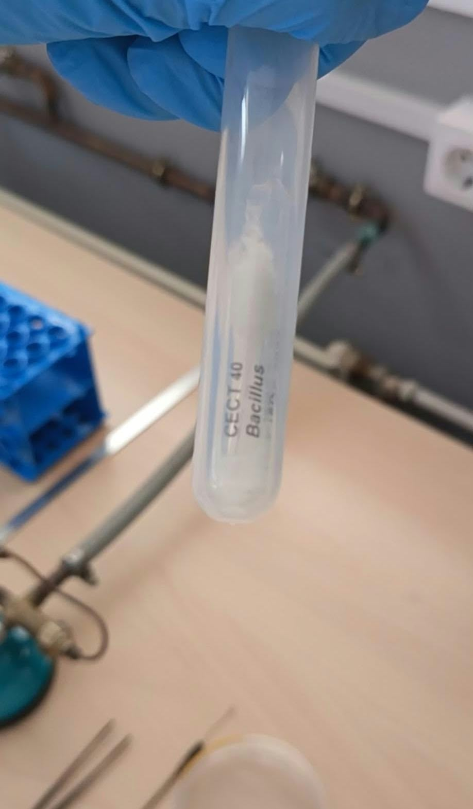
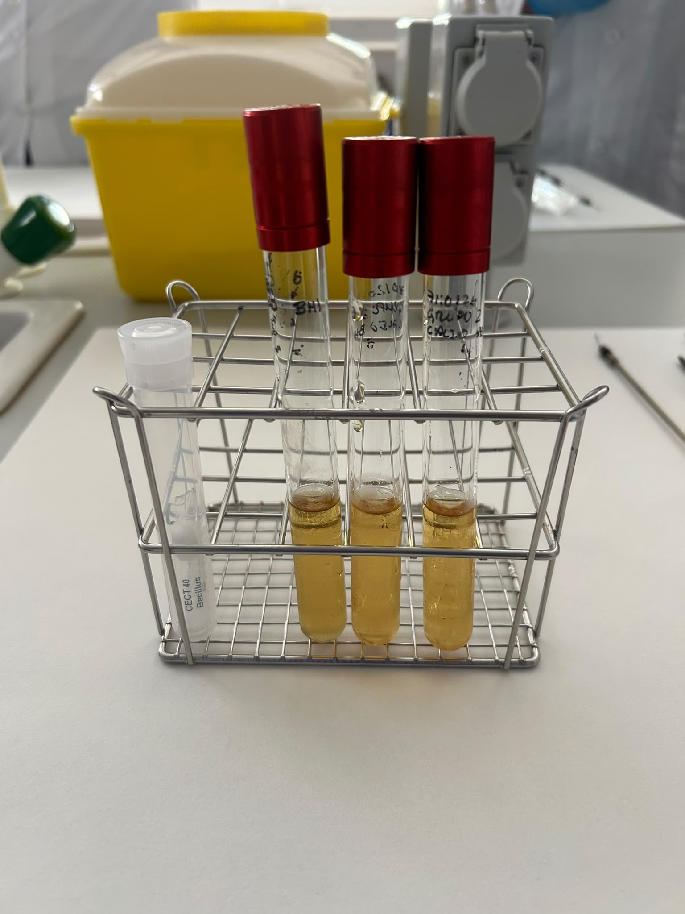
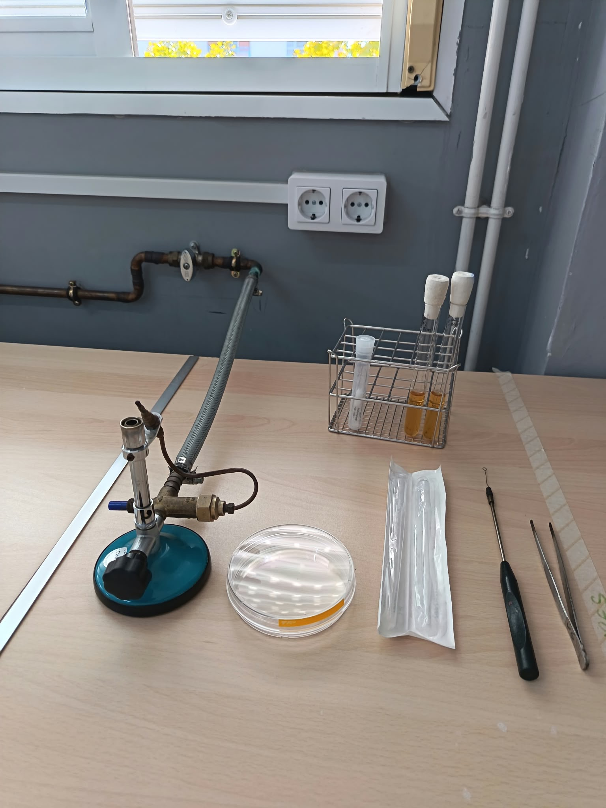
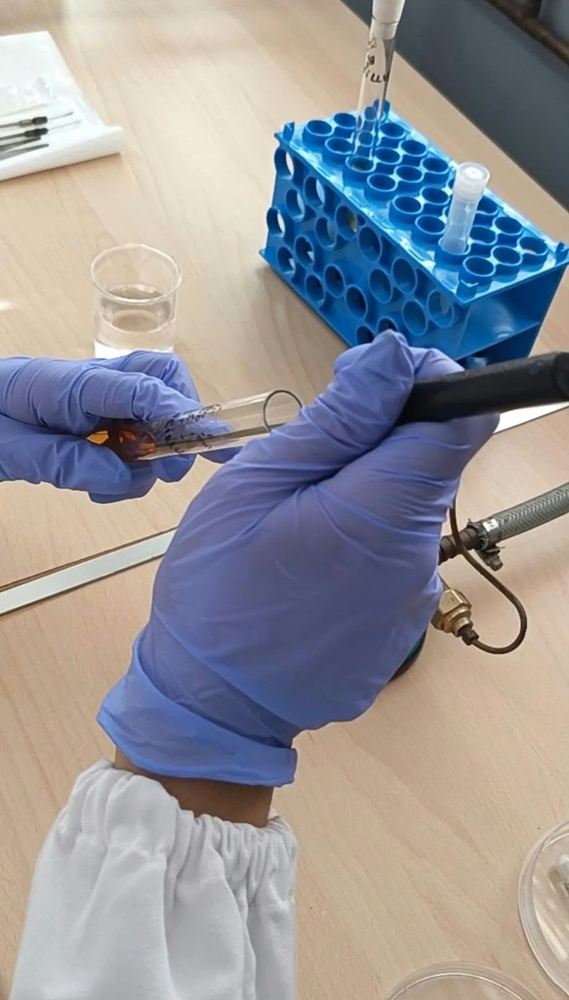
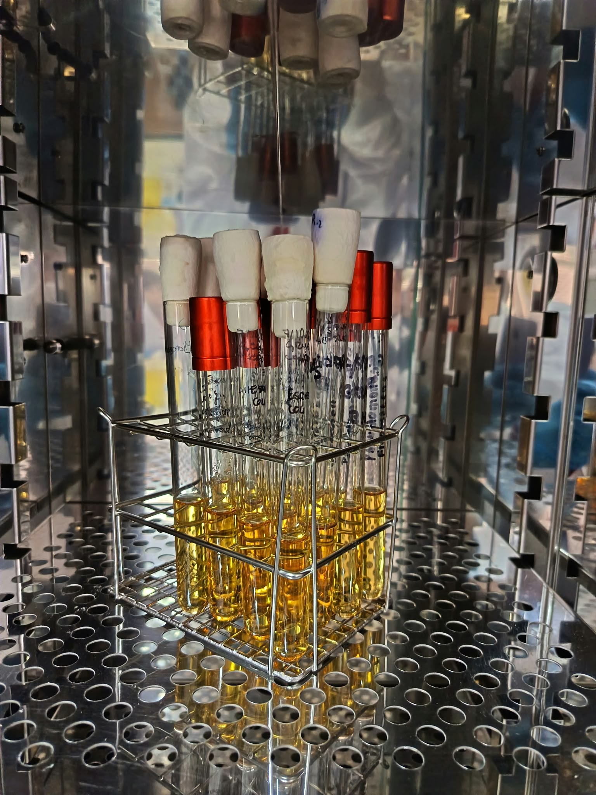
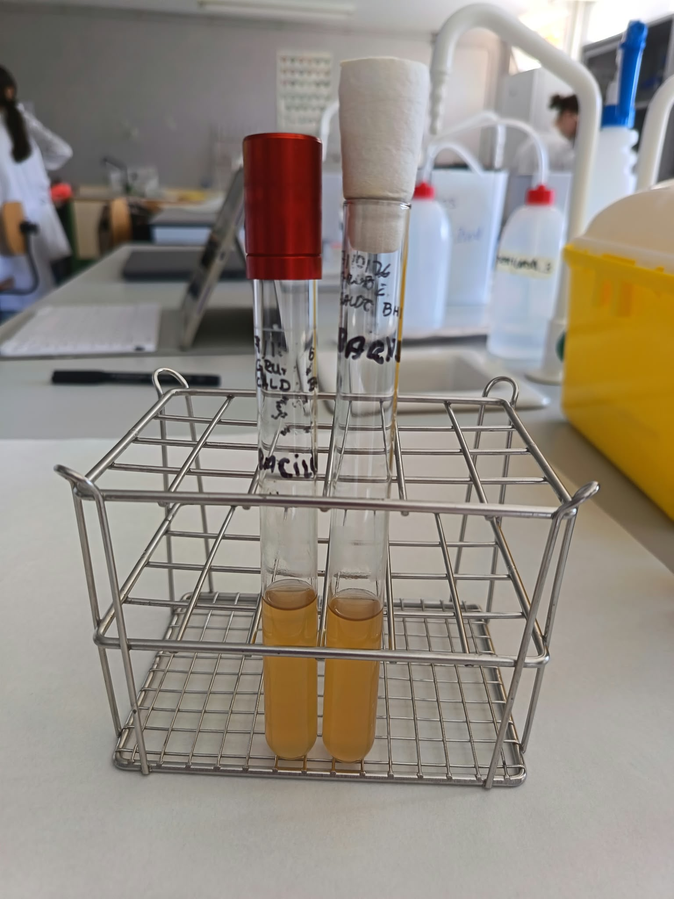

# P08 — Recuperación de cultivos liofilizados

> **Estado de esta página:** Práctica prevista como ejecución real supervisada. Completa individualmente los bloques **[ALUMNADO · RELLENABLE]** durante o después. La ruta B de conservación del polvo solo se realizará si está validada y autorizada por el centro. Si falta una condición de seguridad o protocolo, detén la manipulación y registra la incidencia.

## 1. Identificación de la práctica

| Campo | Información |
|---|---|
| Código y título | `P08 — Recuperación de cultivos liofilizados` |
| Unidad didáctica | `UD3 — Bacteriología: técnicas de cultivo, aislamiento y recuento` |
| Resultados de aprendizaje | `RA03` y `RA04` |
| Criterios de evaluación | `CE03.d–CE03.h; CE04.a–CE04.e` |
| Aprendizaje transversal | `RA01 — bioseguridad` |
| Estado de diseño | `CONDITIONAL_PRACTICE` |
| Instrumentos vinculados | Ejecución supervisada y cuaderno/portfolio, condicionados a la autorización y a la verificación previa de la cepa y del laboratorio. |
| Modalidad prevista | Ejecución real supervisada de recuperación por ruta A o B; cualquier parada o ruta aplicada se registra. |

## 2. Resumen

En esta práctica recuperarás de forma segura y trazable una cepa docente liofilizada en caldo BHI líquido de P07. La ruta A rehidrata el contenido completo; la ruta B toma una pequeña porción de polvo seco y conserva provisionalmente el remanente para posibles reavivados posteriores. La ruta B solo se aplicará con un procedimiento local validado: reponer el algodón y usar un tubo secundario no restablece el cierre de fábrica ni garantiza esterilidad o viabilidad.

## 3. Finalidad y resultados esperados

La liofilización es una forma de conservación a largo plazo que permite mantener material biológico en estado deshidratado. Esta práctica tiene como finalidad comprender el flujo profesional de recuperación de una cepa docente conservada, seleccionando el procedimiento aplicable, manteniendo la trazabilidad y valorando los registros de viabilidad y pureza.

Al finalizar deberás poder:

- explicar el propósito de la liofilización y las fases generales de recuperación;
- identificar qué información debe verificarse antes de recuperar una cepa;
- ejecutar, bajo supervisión y autorización, las fases de apertura, rehidratación e inoculación indicadas para la cepa;
- relacionar trazabilidad, viabilidad y pureza con la calidad del proceso;
- interpretar un registro de recuperación y sus incidencias; y
- justificar por qué una práctica puede detenerse o sustituirse cuando falta una condición de bioseguridad.

## 4. Recursos, seguridad y autorización

**Recursos previstos:** ampolla liofilizada de una cepa docente autorizada; ficha de la cepa e instrucciones vigentes de la colección/proveedor; un tubo de caldo BHI líquido preparado y esterilizado en P07 (8 mL); agua destilada estéril; pipeta Pasteur estéril; pinzas metálicas; recipiente rígido para vidrio; y, para ruta B, cucharilla/microespátula estéril o asa de siembra estéril, algodón original conservado asépticamente y tubo secundario estéril con tapón de rosca. Añade EPI y sistema de trabajo/incubación autorizados localmente.

**Condiciones críticas que debe confirmar el centro:** identidad y grupo de riesgo; autorización y supervisión docente; integridad y trazabilidad de la ampolla; instrucciones específicas de recuperación; compatibilidad del caldo BHI de P07 con la cepa; esterilidad e idoneidad del tubo; sistema de contención y competencia del personal; condiciones de incubación; y rutas de residuos. Si la ficha de la cepa exige otro medio o condición incompatible, no abras la ampolla hasta resolverlo con el responsable.

**Riesgos:** exposición a material biológico, generación de aerosoles, pérdida de trazabilidad, contaminación cruzada, error de identificación y gestión incorrecta de residuos.

**Medidas obligatorias:** no abrir ni manipular la ampolla sin autorización; trabajar con la contención, EPI y técnica aséptica establecidos localmente; proteger los ojos y no tocar vidrio roto con los dedos; mantener trazabilidad; y comunicar de inmediato cualquier rotura, salpicadura, pérdida de material o desviación. No acerques a una llama utensilios aún húmedos con alcohol. En cabinas de seguridad biológica evita las llamas; usa material desechable o esterilizador eléctrico, salvo autorización expresa tras evaluación del centro ([CDC, BMBL](https://www.cdc.gov/labs/bmbl/index.html)).

> **Aviso de seguridad.** La ejecución real queda condicionada a que el responsable confirme todas las condiciones críticas antes de abrir la ampolla. Ante una condición ausente o una incidencia, detén el trabajo y sigue las instrucciones del centro; este cuaderno no autoriza por sí mismo la manipulación.

## 5. Fundamento técnico

La liofilización combina congelación y eliminación de agua por sublimación en condiciones controladas, lo que facilita la conservación prolongada de determinados cultivos. El material liofilizado debe recuperarse utilizando un procedimiento específico de la colección o proveedor, compatible con su identidad, condiciones de conservación y nivel de riesgo.

La calidad de una recuperación no se demuestra por abrir un vial ni por observar un registro aislado. Exige que la identidad permanezca trazable, que se haya seguido el procedimiento autorizado y que los controles posteriores de viabilidad y pureza se interpreten conforme a los criterios establecidos. Una falta de datos, contaminación, crecimiento no esperado o discrepancia de identificación obliga a detener y escalar la incidencia, no a asumir que el material es válido.

El guion P4 y las [instrucciones de la CECT aportadas](https://www.uv.es/uvweb/coleccion-espanola-cultivos-tipo/es/documentacion/instrucciones-tecnicas-procedimientos/instrucciones-uso-productos-cect-1285953961369.html) describen la apertura de la ampolla, la rehidratación y la inoculación. La ruta A sigue la transferencia de la suspensión completa. La ruta B es una opción docente adicional: la guía CECT no describe conservar el polvo en una ampolla abierta ni avala la reposición del tapón. El BHI de P07 solo se usará si la ficha de la cepa lo considera adecuado y el centro valida ambas rutas.

## 6. Flujo de trabajo y controles de calidad

### Flujo general

1. Verificar identidad, grupo de riesgo, integridad, trazabilidad y ficha vigente de la cepa.
2. Confirmar autorización, supervisión, contención, EPI, protocolo local, residuos y condiciones de incubación.
3. Comprobar que el caldo BHI de P07 y el tubo de 8 mL son adecuados para la cepa y están disponibles en condiciones válidas.
4. Elegir la ruta autorizada: A, rehidratación completa; o B, transferencia de una pequeña porción del polvo al BHI y conservación provisional del resto.
5. Incubar el tubo según la ficha de la cepa y el procedimiento local; registrar crecimiento, ausencia de crecimiento e incidencias.
6. Valorar viabilidad y pureza conforme a los controles previstos; no asumir pureza por el aspecto del caldo.
7. Cerrar la trazabilidad, gestionar ampolla, material y residuos según el centro, y subcultivar antes de usar la cepa como cultivo de trabajo.

### Procedimiento específico

**[Instrucciones técnicas de la CECT para recuperación de cultivos liofilizados](https://www.uv.es/uvweb/coleccion-espanola-cultivos-tipo/es/documentacion/instrucciones-tecnicas-procedimientos/instrucciones-uso-productos-cect-1285953961369.html):** ruta A; aplicar junto con la ficha de la cepa y el protocolo de seguridad local.

1. Antes de abrir, confirma autorización, cepa, riesgo, integridad, trazabilidad, ficha específica, compatibilidad del BHI de P07, contención y residuos.
2. Prepara el tubo de BHI de 8 mL, el agua destilada estéril, una pipeta Pasteur estéril, pinzas y un recipiente rígido para vidrio.
3. Coloca el material en la contención y usa el EPI indicados localmente. Confirma que el método de apertura con llama está autorizado en ese sistema; si no, detén el procedimiento.
4. Con el método aprobado, calienta solo la punta estrecha de la ampolla a la llama durante 5–15 s, evitando oscurecer el algodón o calentar el liófilo.
5. Deja caer 1–4 gotas de agua destilada estéril sobre la punta, gota a gota. Si no se agrieta, repite con calentamiento algo más prolongado.
6. Retira los fragmentos con pinzas; nunca con los dedos. Deposítalos en el recipiente rígido y extrae el tapón de algodón con material estéril.
7. Con pipeta Pasteur estéril, añade 0,2–0,3 mL del BHI del tubo de P07 y resuspende suavemente, evitando burbujas.
8. Si las condiciones de esterilidad se mantienen, deja rehidratar 20–30 min. No guardes una fracción de la suspensión en la ampolla abierta.
9. Transfiere toda la suspensión al mismo tubo de BHI de 8 mL; no añadas medio sólido en esta práctica. Cierra e identifica según el protocolo local.
10. Incuba con la temperatura, atmósfera, luz y duración especificadas en la ficha de la cepa y el procedimiento del centro.
11. Registra crecimiento e incidencias en los tiempos de lectura indicados. Algunas cepas presentan latencia prolongada; no declares inviabilidad antes del límite del protocolo.
12. Valora viabilidad y pureza mediante los controles autorizados. Subcultiva al menos una vez después de la activación y antes de usar la cepa como cultivo de trabajo.

#### Procedimiento específico B — Recuperación de una porción y conservación provisional del polvo restante

Esta alternativa resulta útil si se quiere reservar parte del liófilo seco para intentar reavivados posteriores. La CECT no especifica esta conservación en una ampolla abierta: el algodón original y el tubo secundario no restituyen el sellado ni el vacío de fábrica. El centro debe validar la técnica, el recipiente y las condiciones de almacenamiento; la reserva no se considerará estéril ni viable sin comprobación.

1. Realiza los pasos 1–6 de la ruta A para verificar y abrir la ampolla; conserva el tapón original de algodón en condiciones asépticas, sin apoyarlo en superficies.
2. Esteriliza a la llama un asa de siembra o una cucharilla/microespátula tras sumergirlas en etanol; deja evaporar el etanol por completo y usa llama solo donde esté autorizada.
3. Toma con el utensilio estéril una pequeña cantidad de polvo, evitando dispersarlo, e inocúlala directamente en el tubo de BHI de P07.
4. Recoloca el algodón original de manera aséptica, siempre que permanezca íntegro y no contaminado.
5. Introduce la ampolla tapada en un tubo de muestras estéril con tapón de rosca, identifícalo y almacénalo solo bajo las condiciones validadas por el centro; anota fecha y responsable.
6. Registra la reserva como provisional: no se ha recuperado el cierre original y su esterilidad/viabilidad posterior no está garantizada. Para reavivarla, sigue el procedimiento aprobado y verifica el cultivo.

### Controles de calidad

- Autorización, identidad, riesgo, ficha de la cepa y responsable registrados antes de abrir.
- Compatibilidad del BHI de P07, estado del tubo y condiciones de incubación confirmados.
- Integridad de la ampolla, trazabilidad y desviaciones registradas.
- Ruta A o B identificada; en la ruta B, algodón y utensilio manejados asépticamente, ampolla contenida en tubo secundario y condiciones de almacenamiento anotadas.
- La reserva de la ruta B se considera provisional; no se declara conservación validada sin control posterior de esterilidad y viabilidad.
- Crecimiento y controles de viabilidad/pureza interpretados conforme a la ficha; ausencia de turbidez no se convierte automáticamente en inviabilidad.
- Incidencias documentadas con su decisión asociada.
- Imágenes o evidencias identificadas como ejecución real o demostración autorizada, sin atribuir una modalidad distinta.

---

# Tu cuaderno de prácticas

## 7. Datos de realización [ALUMNADO · RELLENABLE · DURANTE]

- **Nombre y apellidos:** Natalia Carrasco Jiménez
- **Fecha real de realización:** 28-10-2026
- **Grupo:** Laboratorio Clínico y Biomédico
- **Pareja o equipo, si procede:** En pareja,Cristina Llamazares Santiago
- **Rol o tarea principal que realizaste:** Tuvimos que sembrar 2 tubos,entonces uno lo hizo mi compañera y otro yo.Consistía en sembrar una pequeña cantidad de polvo en el medio de cultivo contenido en el tubo.
- **Modalidad y ruta realmente realizadas:** Ejecución real supervisada, ruta B 
- **Referencia de vial, registro o caso docente:** Bacuillus,CECT 40.
- **Responsable que autorizó y supervisó la ejecución:** Profesor de laboratorio.

## 8. Preparación y análisis inicial [ALUMNADO · RELLENABLE · DURANTE]

### 8.1 Verificación previa

Enumera los recursos reales: incluye el tubo de BHI de 8 mL de P07 y el material de la ruta aplicada. Para B añade utensilio estéril y tubo secundario de rosca. Escribe «No aplica» cuando corresponda y clasifica los residuos según el centro.

| Elemento | Listado del alumnado |
|---|---|
| Instrumental | Asa de siembra,pinzas y gradilla |
| Equipos | Mechero Bunsen |
| Reactivos/materiales | Tubos de ensayo con medio de cultivo y tubo con el microorganismo liofilizado  |

| Residuo previsto | Tipo |
|---|---|
| Papel utilizado para limpiar la zona de trabajo sin contaminación biológica | Urbanos o asimilables a los urbanos |

## 9. Observaciones y resultados [ALUMNADO · RELLENABLE · DURANTE]

### 9.1 Registro de observaciones y cálculos

Registra datos de la ejecución real o indica si la actividad se detuvo antes de abrir. Escribe «No aplica» en cálculos o equipos cuando corresponda; no inventes parámetros ausentes de la ficha de la cepa o del equipo.

| Aspecto | Registro del alumnado |
|---|---|
| Cálculos (si procede) | En esta práctica no tuvimos que realizar ningún cálculo |
| Configuración de equipos (si procede) | Sistema de contención:zona de trabajo aséptica alrededor del mechero Bunsen.Equipo de incubaión:incubadora del laboratorio.Temperatura:la temperatura real programada en la incubadora.Tiempo de incubación:el tiempo establecido en el protocolo.Fuente de los parámetros:protocolo local del laboratorio y ficha de la cepa.|
| Características del producto o resultado final | Se realizó la recuperación del microorganismo liofilizado siguiendo la ruta B. Después de la siembra, los tubos se introdujeron en la incubadora para favorecer el crecimiento microbiano. Se observó crecimiento de Bacillus.Una vez obtenido el crecimiento, los tubos se trasladaron al frigorífico para su conservación. El resultado fue satisfactorio, ya que se observó crecimiento bacteriano. El tiempo y la temperatura de incubación fueron 24h a 37 grados centígrados.No se pueden confirmar la pureza del cultivo sin realizar controles adicionales. |

## 10. Evidencias visuales [ALUMNADO · RELLENABLE · DURANTE Y DESPUÉS]

> Registra entre cinco y ocho evidencias de las fases principales, solo si el responsable y las normas del centro permiten fotografiarlas. No fotografíes la apertura o el material biológico si ello interfiere con la contención. Excluye rostros, datos personales y códigos o etiquetas sensibles; marca cualquier evidencia demostrativa.

### Imagen 1 — Verificación previa y trazabilidad

- **Pie de foto:** Verificación de integridad, identificación y registro, sin mostrar códigos sensibles
- **Modalidad de la evidencia:** Ejecución real 
- **Autoría y origen:** Propia / compartida con tu equipo

### Imagen 2 — Material preparado: BHI de P07

- **Pie de foto:** Tubo de BHI de P07 y material dispuesto antes de abrir la ampolla
- **Control de seguridad asociado:** Verificación previa del medio y del puesto
- **Origen de la imagen:** Propia / demostración docente; especifica

### Imagen 3 — Preparación del área de trabajo

- **Pie de foto:** Preparación del material de laboratorio,istema de contención y EPI, utilizados para la recuperación de microorganismos liofilizados.
- **Control de seguridad asociado:** Se comprobó el uso de bata y guantes. Se trabajó junto al mechero Bunsen para mantener condiciones asépticas, evitando contaminaciones y la dispersión del material utilizado. Se siguieron las normas de bioseguridad y gestión de residuos del laboratorio.
- **Autoría y origen:** Fotografía realizada durante la práctica.Material y preparación correspondiente a la práctica.

### Imagen 4 — Rehidratación o toma de polvo y cierre secundario

- **Pie de foto:** Introducción del microorganismo liofilizado en el tubo con medio de cultivo BHI, mediante el procedimiento recuperación correspondiente a la ruta B.
- **Modalidad y momento:** Ejecución real 
- **Autoría y origen:** Fotografía realizada durante la práctica.Corresponde a la siembra de Bacillus en medio BHI mediante la ruta B.

### Imagen 5 — Tubo inoculado y entrada a incubación

- **Pie de foto:** Estado del tubo tras transferir la suspensión y antes de incubarlo
- **Parámetros de incubación:** 24h a 37 grados.
- **Autoría y origen:** Fotografía realizada durante la práctica.Podemos ver como se meten los tubos puestos en la gradilla dentro de la incubadora.

### Imagen 6 — Lectura del resultado

- **Pie de foto:** tubo de ensayo con medio BHI inoculado con Bacillus, en el que se observa turbidez tras el periódo de incubación, compatible con crecimiento microbiano.
- **Relación con la interpretación:** La turbidez observada permite concluir que hubo crecimiento microbiano en el caldo BHI. Sin embargo, queda pendiente confirmar la identidad y pureza del cultivo mediante pruebas específicas, ya que el aspecto del caldo por si solo no es suficiente.
- **Autoría y origen:** Fotografía realizada durante la práctica.Muestra el resultado de la incubación del tubo con medio BHI inoculado con Bacillus.

## 11. Incidencias, errores y medidas correctoras [ALUMNADO · RELLENABLE · DURANTE]

| Incidencia, error o duda detectada | Posible causa | Medida correctora, decisión de parada o escalado | ¿Afectó al resultado? |
|---|---|---|---|
| No se detectaron incidencias |  |  |  |

## 12. Interpretación técnica [ALUMNADO · RELLENABLE · DESPUÉS]

Interpreta la trazabilidad y el resultado del tubo de BHI a partir de los registros y controles disponibles. Distingue crecimiento observado, viabilidad confirmada y pureza; explica cómo una desviación, ausencia de crecimiento o dato no disponible cambia la decisión profesional.

El tubo de BHI presentó crecimiento de Bacillus tras la incubaión, indicando un resultado positivo y sugiriendo viabilidad del microorganismo. La trazabilidad se mantuvo mediante la identificación y registro del tubo. Sin embargo, el crecimiento no confirma la pureza del cultivo.

## 13. Conclusión [ALUMNADO · RELLENABLE · DESPUÉS]

¿En qué medida el procedimiento seguido y el resultado obtenido permitieron alcanzar el objetivo de recuperar la cepa en BHI líquido? Si aplicaste B, valora además si el remanente puede considerarse una reserva fiable. Justifica ambas valoraciones.

El procedimiento realizado siguiendo la ruta B permitió recuperar la cepa de Bacillus en medio BHI,observándose crecimiento tras la incubación.El tubo quedó identificado y se conservó en el frigorífico.El resultado fue satisfactorio,aunque el crecimiento observado no garantiza del todo la pureza del cultivo.

## 14. Reflexión profesional [ALUMNADO · RELLENABLE · DESPUÉS]

Responde de forma razonada a las cuatro preguntas. Relaciona cada respuesta con registros, observaciones o imágenes incluidas en tu cuaderno.

1. **Procedimiento:** ¿Qué verificaste antes de abrir la ampolla y por qué debe comprobarse que el BHI de P07 es adecuado para esa cepa? Si aplicaste B, ¿cómo evitaste contaminar o dispersar el polvo?

   Antes de abrir la ampolla, se comprueba la identificación de la cepa, el estado del recipiente y la fecha de caducidad. También se verificó que el medio BHI preparado en la práctica anterior, fuera adecuado para el crecimiento de vacíos. Se aplicó la ruta B, trabajando junto al mechero Bunsen y manipulando el liofilizado con cuidado para evitar la dispersión del polvo es posible contaminaciones.

2. **Interpretación:** ¿Qué evidencias permiten valorar crecimiento, viabilidad y pureza, y qué limitación tiene observar solo el aspecto del caldo?

   El crecimiento se evidenció por la turbidez del caldo BHI y la presencia de crecimiento de Bacillus. Esto sugiere que la bacteria mantiene su viabilidad. Sin embargo, observar únicamente el aspecto al caldo no permite confirmar la identidad ni la póliza del cultivo, ya que podrían existir otros microorganismos. Ahora comprobarlo serían necesarios, controles y pruebas adicionales.

3. **Conclusiones:** ¿Qué decisión profesional tomarías con el resultado y los controles disponibles: continuar, repetir, detener o escalar? Explica el criterio aplicado.

   La decisión sería continuar con la conservación del cultivo, ya que se observó crecimiento de Bacillus en el caldo BHI. Sin embargo, antes de confirmar la pureza y aceptar definitivamente el resultado, sería necesario realizar controles adicionales. Si se aparecieran, anomalías o contaminación, se debería de tener procedimiento y comunicarlo al profesor.

4. **Aprendizaje y transferencia:** ¿Qué principio de trazabilidad o bioseguridad aplicarás cuando trabajes con material conservado, medios de cultivo o resultados de identificación en prácticas posteriores?

   Aplicaré una correcta, identificación y trazabilidad de los tubos, anotando, la cepa, el medio de cultivo,y el grupo. Mantendré las medidas de asepsia y utilizaré los equipos de protección para evitar contaminaciones y garantizar resultados fiables en otras prácticas.

## 15. Trazabilidad y entrega [ALUMNADO · RELLENABLE · DESPUÉS]

| Campo | Registro del alumnado |
|---|---|
| Identificador de práctica | `P08` |
| Fecha | 28/10/2026 |
| UD / RA / CE | `UD3 / RA03-RA04 / CE03.d–CE03.h; CE04.a–CE04.e` |
| Agrupamiento | En pareja;con Cristina Llamazares Santiago |
| Modalidad y origen de la evidencia | Ejecución real supervisada, ruta B  |
| Referencia autorizada de protocolo o caso | Protocolo de prácticas del laboratorio para la recuperación de microorganismos liofilizados mediante la ruta B,utilizando medio de cultivo BHI,bajo supervisión del profesor. |
| Controles |    Se comprobó la identificación de la cepa,el estado del material y la adecuación del medio BHI.Se observó crecimiento de Bacillus tras la incubación,como evidencia del resultado.No se realizaron controles específicos de pureza. |
| Resultado | se recuperó la cepa de Bacillus mediante la ruta B en caldo BHI. Se observó crecimiento tras la incubación y el tubo se conservó el frigorífico, quedando identificado y registrado.|
| Interpretación | El tubo de BHI presentó crecimiento de Bacillus tras la incubaión, indicando un resultado positivo y sugiriendo viabilidad del microorganismo. La trazabilidad se mantuvo mediante la identificación y registro del tubo. Sin embargo, el crecimiento no confirma la pureza del cultivo. |
| Incidencias, medidas y escalado | No se detectaron incidencias |
| Ruta de residuos o devolución del material | Papel utilizado para limpiar la zona de trabajo sin contaminación biológica:urbanos o asimilables a los urbanos |  |
| Estado de entrega | Entregado |

---
